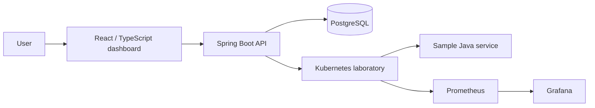
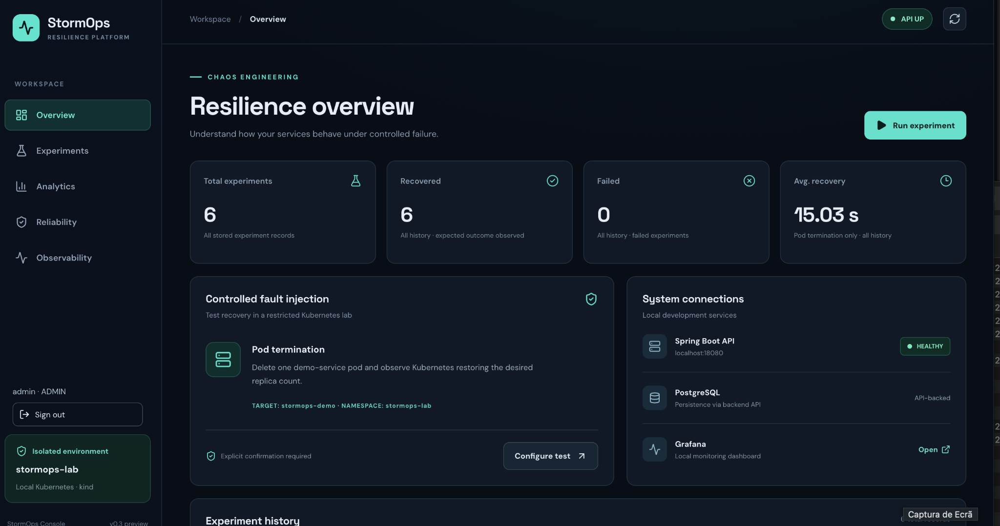
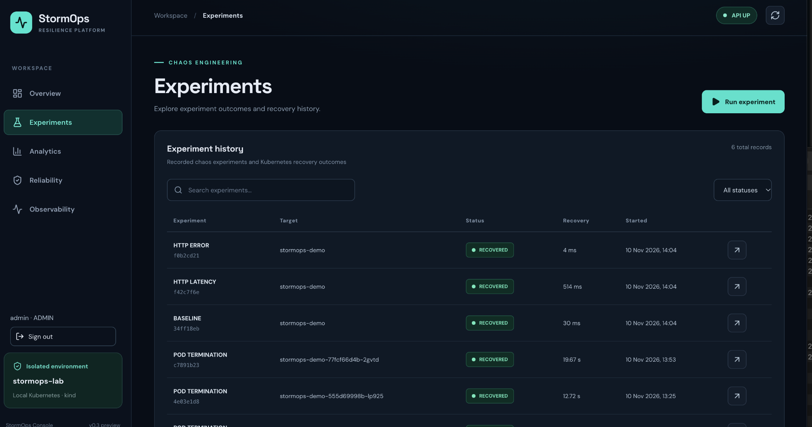
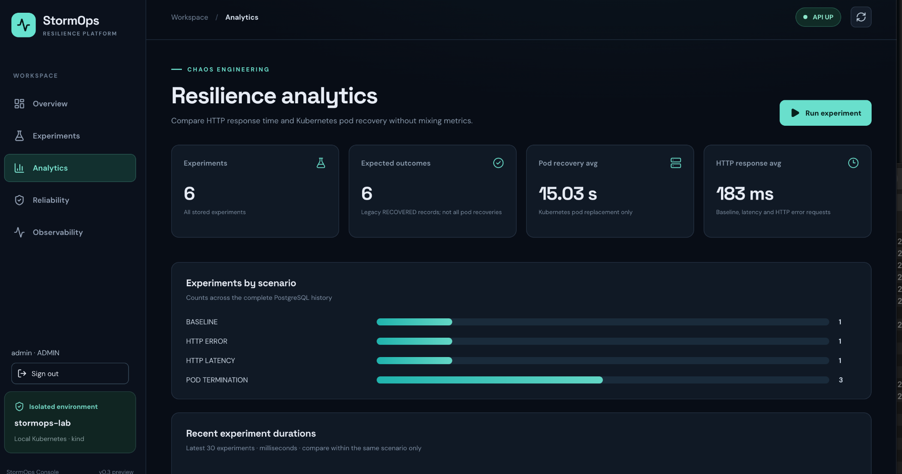
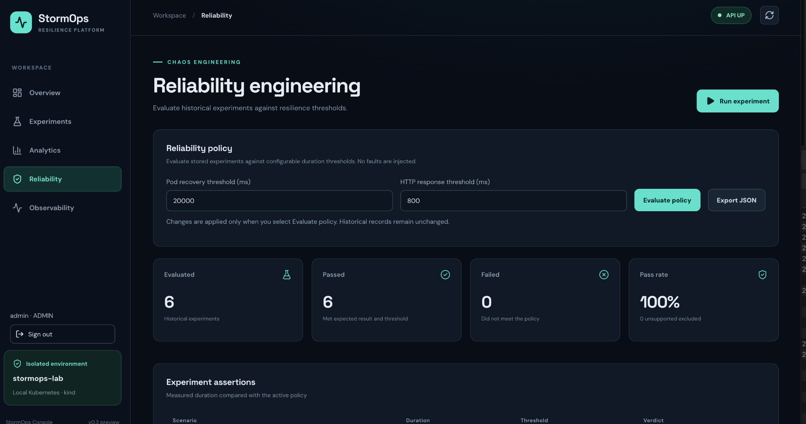
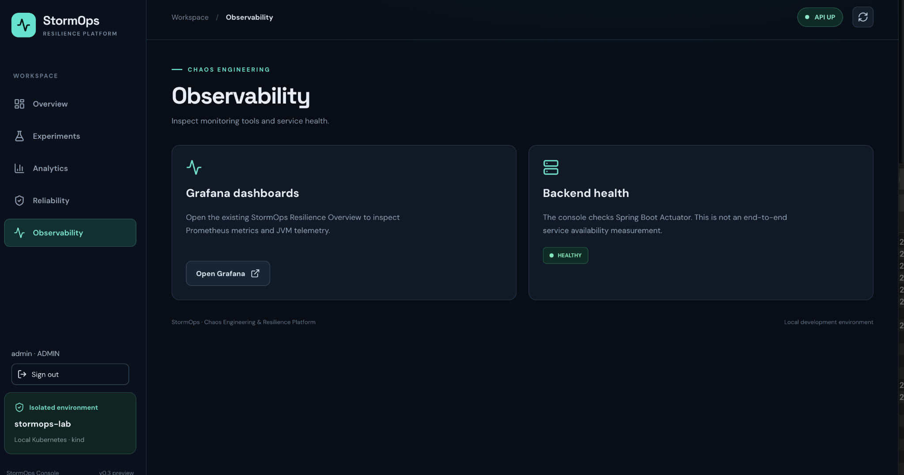
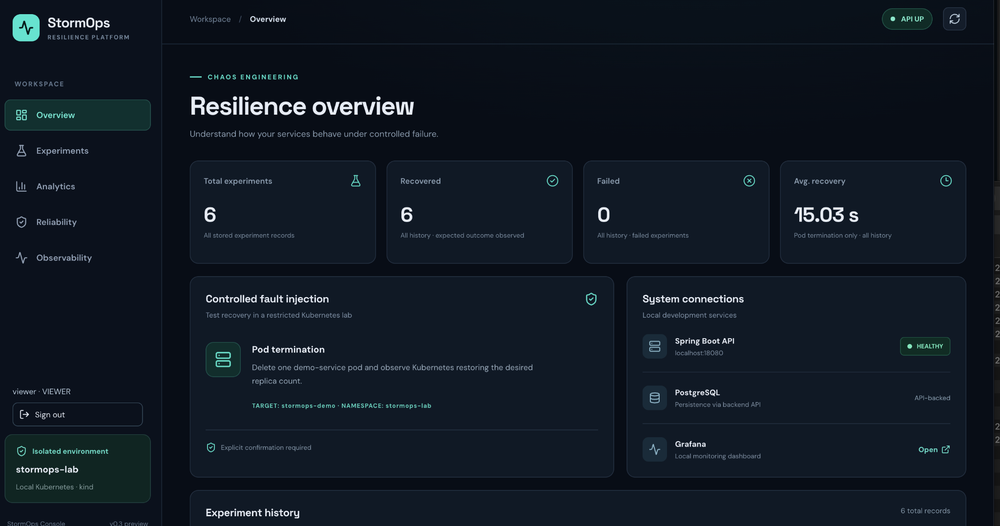
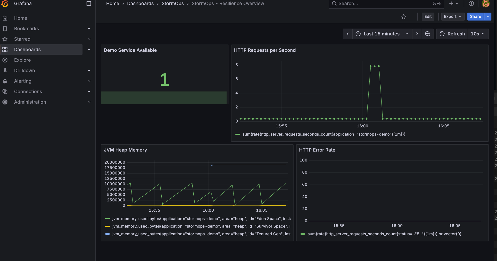

# StormOps

**Cloud-native chaos engineering and resilience testing platform**

[](https://github.com/samueltexas/StormOps/actions/workflows/ci.yml)

StormOps is a local-first engineering project for conducting controlled resilience experiments against a Kubernetes-based demonstration environment, inspecting experiment results, and exploring service reliability. It combines a Java/Spring Boot API, a React/TypeScript interface, PostgreSQL persistence, and infrastructure for monitoring with Prometheus and Grafana.

> **Project scope:** An engineering portfolio and local laboratory, not a production-ready fault-injection service. Use only against workloads you own or are explicitly authorized to test.

## Features

- Backend APIs for experiment execution and result retrieval.
- A React dashboard for interacting with the platform.
- PostgreSQL-backed experiment history with Flyway migrations.
- Authentication and role-aware UI behavior for administrator and viewer accounts in the local environment.
- A sample Java service and Kubernetes manifests for controlled experiments.
- Monitoring configurations for Prometheus and Grafana.
- Automated backend unit tests, PostgreSQL integration tests, frontend tests, and production frontend builds in GitHub Actions.

## Technology stack

| Area | Technologies |
| --- | --- |
| Backend | Java (target 21), Spring Boot 4.1.2, Maven Wrapper |
| Frontend | React 19, TypeScript, Vite 8, Lucide React |
| Data | PostgreSQL, Spring JDBC, Flyway |
| Testing | Spring Boot Test, Testcontainers, Vitest, React Testing Library |
| Infrastructure | Docker, Kubernetes, kind |
| Observability | Prometheus, Grafana |
| CI | GitHub Actions, Temurin JDK 21/25, Node.js 24, Python 3.9 |

## Architecture



This is a conceptual overview. Local setup scripts and Kubernetes manifests are located in `scripts/` and `infrastructure/`.

## Repository layout

```text
StormOps/
├── .github/workflows/ci.yml       # Continuous integration
├── backend/                       # Spring Boot API and tests
├── frontend/                      # React UI and tests
├── demo-services/                 # Java sample workload
├── infrastructure/                # Docker and Kubernetes manifests
├── scripts/                       # Local laboratory scripts
└── docs/                          # Architecture decisions and notes
```

## Requirements

For local development, install:

- JDK 21 or 25 (the backend targets Java 21; CI verifies both)
- Node.js 24 and npm
- Docker Desktop with a working Docker engine
- `kubectl` and `kind` for the Kubernetes laboratory

The repository includes Maven Wrapper scripts; a separate Maven installation is not required for the backend.

## Run tests locally

### Backend unit tests

```bash
cd backend
./mvnw test
```

### Backend integration tests

Start Docker Desktop first. Integration tests use Testcontainers to provision an isolated PostgreSQL container.

```bash
cd backend
./mvnw -Pintegration-tests verify
```

### Frontend tests and build

```bash
cd frontend
npm ci
npm test
npm run build
```

## V3 local operations

Use the dependency-free Python CLI to inspect the existing lab without changing Kubernetes resources:

```bash
python3 scripts/stormops.py doctor
python3 scripts/stormops.py status --json
```

To start the secured API or React UI deliberately, use `python3 scripts/stormops.py start-api` or `python3 scripts/stormops.py start-ui`. These reuse existing launchers and never run legacy installers. Review [local operations](docs/LOCAL_OPERATIONS.md) for safety checks and limitations.

## Local environment

The application is designed for a local Kubernetes laboratory. Review the scripts in `scripts/` and manifests in `infrastructure/` before running them. Database connection settings and authentication credentials are supplied through environment variables; **do not commit local secrets or Kubernetes credentials**.

The backend's default configuration binds to `127.0.0.1:18080`. The local database configuration expects PostgreSQL on `127.0.0.1:15432`. These defaults are intended for local development, not public exposure.

> **v2.0 safety:** Authentication is enabled by default; missing credentials prevent startup. Disabling it requires both the explicit `dev` profile and `STORMOPS_SECURITY_ENABLED=false`. Experiments default to dry-run and the durable kill switch starts engaged. Read the [v2 safety and recovery guide](docs/V2_SAFETY.md) before operating. This remains a local laboratory, not a production-hardened service.

## Continuous integration

The [StormOps CI workflow](https://github.com/samueltexas/StormOps/actions/workflows/ci.yml) runs on pushes and pull requests. It verifies Java 21/25 package and PostgreSQL integration tests, frontend tests and production build, a real disposable-kind recovery experiment, and container image smoke tests. The [published-image E2E workflow](.github/workflows/release-image-e2e.yml) independently proves the v2.0.0 release artifacts by immutable digest. The [local operator workflow](.github/workflows/operator-cli.yml) tests the V3 Python CLI. Release publication remains explicitly gated on version tags; pull requests never publish packages.

The initial public workflow run completed successfully: [run #42836614444](https://github.com/samueltexas/StormOps/actions/runs/42836614444).

## Documentation

- [Local chaos control-plane decision](docs/architecture/decisions/0002-local-chaos-control-plane.md)
- [PostgreSQL experiment-history decision](docs/architecture/decisions/0003-postgresql-experiment-history.md)
- [Phase 4 notes](docs/PHASE4.md)

## Project status

**Active portfolio project.** The initial platform, automated tests, and CI pipeline are implemented. Documentation and developer experience continue to evolve. Production deployment, multi-tenant isolation, and production-grade security are not claimed.

## Author

**Samuel Texa**
[GitHub: @samueltexas](https://github.com/samueltexas)

## License

Licensed under the [MIT License](LICENSE). Copyright (c) 2026 Samuel Texa.

<!-- STORMOPS_SCREENSHOTS_START -->
## Product screenshots

Real screenshots from the local StormOps development environment. The application runs against an isolated kind Kubernetes lab; results shown are historical test data, not production service-level guarantees.

### Administrator overview


### Experiment history


### Resilience analytics


### Reliability policy evaluation


### Observability integration


### Read-only viewer experience


> **Security and operations:** The viewer screenshot illustrates UI-level restrictions; authorization is enforced separately by the backend. Grafana availability depends on the local monitoring stack. See [Security](docs/SECURITY.md), [Testing](docs/TESTING.md), and [Known limitations](docs/KNOWN_LIMITATIONS.md).
<!-- STORMOPS_SCREENSHOTS_END -->

<!-- STORMOPS_GRAFANA_START -->
### Live observability — Grafana and Prometheus

Real monitoring of the local StormOps Kubernetes demo service, including service availability, HTTP request throughput, JVM heap memory, and HTTP 5xx error rate.



> Local lab screenshot; monitoring access requires the local Kubernetes cluster and port-forwarding.
<!-- STORMOPS_GRAFANA_END -->

## v2 verification and delivery

Java 21 bytecode is explicit and CI tests JDK 21 and 25. A disposable kind E2E job verifies restricted ServiceAccount permissions, performs one real pod termination through the authenticated API, and checks replacement, steady state and durable audit. Version-tag publishing to GHCR is gated on the complete suite; it never deploys automatically. See [CI and container delivery](docs/CI_DELIVERY.md) for credential provisioning, evidence and release steps. The [v2.0.0 release](https://github.com/samueltexas/StormOps/releases/tag/v2.0.0) records published immutable image digests, independently validated in CI.

## Release v2.0.0

The API and demo service are versioned **2.0.0**, targeting Java 21 with Java 21/25 CI coverage. Read the [release notes](docs/releases/v2.0.0.md) for changes, upgrade requirements and operational limits. The [release page](https://github.com/samueltexas/StormOps/releases/tag/v2.0.0) records published image digests after all gates pass.
