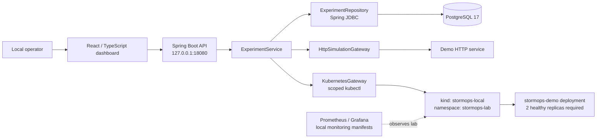
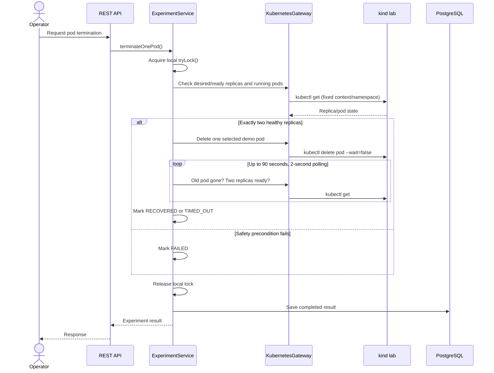

# StormOps — Architecture and Engineering Decisions

> **Scope:** Local-first chaos engineering laboratory and portfolio project. Not a production-ready fault-injection platform. Run experiments only against systems you own or are authorized to test.

## System overview

StormOps combines a React/TypeScript interface, a Spring Boot API, PostgreSQL persistence, and a dedicated local Kubernetes (`kind`) laboratory. Prometheus and Grafana configuration files support observability of the lab. The backend runs on the developer workstation and invokes a narrowly scoped `kubectl` adapter for Kubernetes operations.

The HTTP gateway and the monitoring connections are shown at a conceptual level. Their exact networking and scrape configuration should be checked against the corresponding source and manifests before extending this diagram.

## Key components

| Component | Responsibility | Evidence in repository |
| --- | --- | --- |
| React frontend | Local dashboard, authentication-aware UI, experiments and results | `frontend/src/App.tsx`, `frontend/src/App.test.tsx` |
| REST controllers | Experiment endpoints, analytics summary and reliability report | `backend/src/main/java/com/stormops/api/api/` |
| `ExperimentService` | Input validation, concurrency guard, experiment orchestration, result persistence | `backend/src/main/java/com/stormops/api/core/ExperimentService.java` |
| `KubernetesGateway` | Fixed-scope Kubernetes queries and pod deletion through `kubectl` | `backend/src/main/java/com/stormops/api/kubernetes/KubernetesGateway.java` |
| `HttpSimulationGateway` | Bounded HTTP experiment requests | `backend/src/main/java/com/stormops/api/core/HttpSimulationGateway.java` |
| `ExperimentRepository` | Persist and query experiment results | `backend/src/main/java/com/stormops/api/persistence/ExperimentRepository.java` |
| PostgreSQL / Flyway | Durable experiment history and schema migration | `infrastructure/docker/compose.database.yaml`, `backend/src/main/resources/db/migration/` |
| GitHub Actions | Unit tests, integration tests, frontend tests and build | `.github/workflows/ci.yml` |

## Experiment lifecycle

### Kubernetes pod termination

The service requires `desiredReplicas == 2`, `readyReplicas == 2`, and exactly two running matching pods before deletion. A recovery is observed when the old pod disappears and the desired number of replicas is ready. This measures **Kubernetes readiness recovery**, not end-user availability or a formal service-level objective.

### HTTP simulations

The service accepts `BASELINE`, `HTTP_LATENCY`, and `HTTP_ERROR`. For latency experiments, the requested delay is limited to **0–2000 ms**; other experiment types must use zero delay. The service compares the response against an expected HTTP status (`200` for baseline/latency, `503` for error injection), records the observed request duration and persists the result. In HTTP records, `recoveryMillis` represents **elapsed request time**, not pod recovery time.

## HTTP API surface

The controllers expose the following route patterns:

| Method | Route | Purpose |
| --- | --- | --- |
| GET | `/api/v1/experiments` | Recent experiment history |
| GET | `/api/v1/experiments/page` | Paginated history |
| GET | `/api/v1/experiments/{id}` | Single experiment |
| POST | `/api/v1/experiments/pod-termination` | Controlled pod termination |
| POST | `/api/v1/experiments/http-simulation` | HTTP experiment |
| GET | `/api/v1/analytics/summary` | Analytics summary |
| GET | `/api/v1/reliability/report` | Reliability report |

Request/response payloads, confirmation headers and access requirements should be taken directly from the controllers and security configuration; they are intentionally not guessed here.

## Safety boundaries

- The Kubernetes adapter fixes the context (`kind-stormops-local`), namespace (`stormops-lab`), deployment (`stormops-demo`) and selector (`app=stormops-demo`); callers cannot supply arbitrary shell commands or workload names.
- The adapter uses a dedicated kubeconfig at `~/Projects/StormOps/.kube/stormops-config` and `ProcessBuilder` rather than a shell. Individual Kubernetes subprocesses have a **12-second timeout**.
- A local `ReentrantLock` prevents overlapping experiments **within one API process**. It is **not a distributed lock**.
- The API configuration binds to `127.0.0.1` by default. Local authentication can be enabled via environment configuration; the default `stormops.security.enabled=false` is **not suitable for an exposed deployment**.
- Credentials and kubeconfig files must remain outside Git; no real credentials should appear in documentation or examples.

## Persistence and consistency limitations

PostgreSQL 17 runs in a dedicated Docker Compose setup; Flyway manages schema migration. Completed experiment outcomes survive API restarts if the database volume remains intact. There is no durable `RUNNING` state or distributed lock in the documented design. If persistence fails after a pod is deleted, the operation may have happened without a durable audit record. This must be addressed before any production deployment.

## Testing and CI

`.github/workflows/ci.yml` defines three jobs on `push` and `pull_request`:

1. **Backend unit tests:** Temurin 25, Maven `test`.
2. **Backend integration tests:** Temurin 25, Docker availability, Maven `-Pintegration-tests verify` with isolated PostgreSQL via Testcontainers.
3. **Frontend tests and build:** Node 24, `npm ci`, `npm test`, `npm run build`.

The first published run completed successfully: [StormOps CI run 42836614444](https://github.com/samueltexas/StormOps/actions/runs/42836614444). The README update run should be checked separately before claiming it passed.

## Architectural decisions and next steps

See [ADR 0002](architecture/decisions/0002-local-chaos-control-plane.md) for the local Kubernetes control-plane boundaries and [ADR 0003](architecture/decisions/0003-postgresql-experiment-history.md) for persistence tradeoffs. Some historical statements in these ADRs describe earlier phases (for example, in-memory history and no authentication); the current implementation has since added persistence and opt-in local authentication.

Future production-hardening work would include a scoped Kubernetes service identity, enforced authentication, durable experiment lifecycle state, distributed locking, reliable audit logging, and externally meaningful availability/SLO measurements. These are **future improvements**, not claims of current functionality.

---

**Author:** Samuel Texa
**Repository:** https://github.com/samueltexas/StormOps
